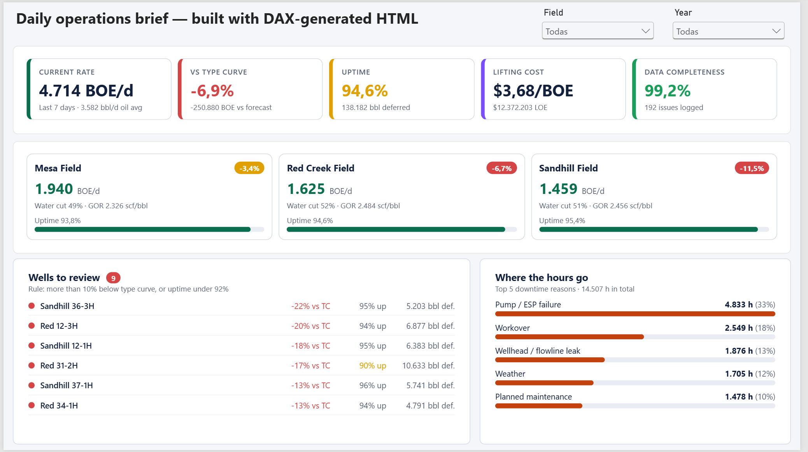
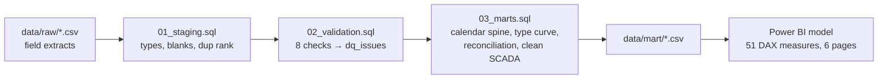
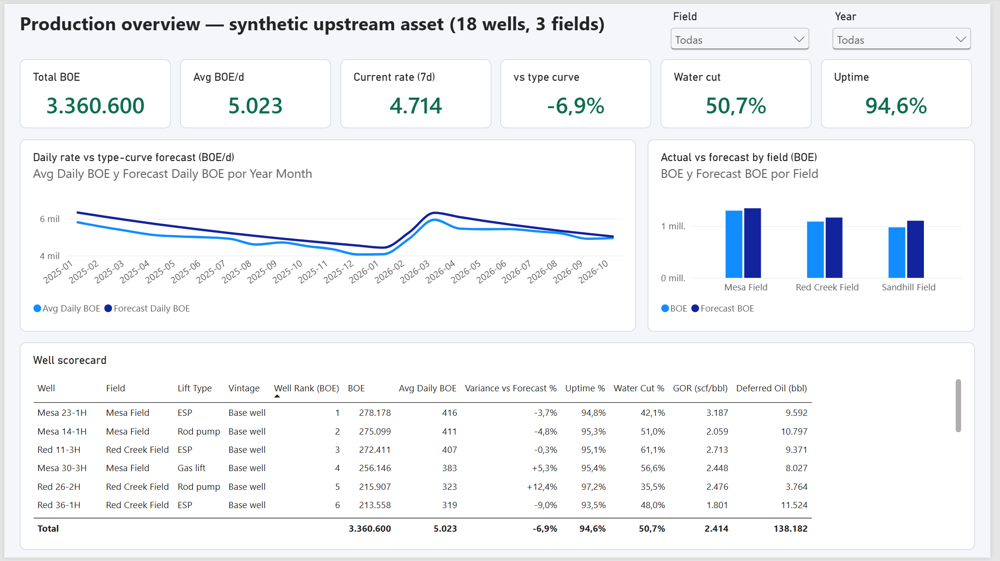
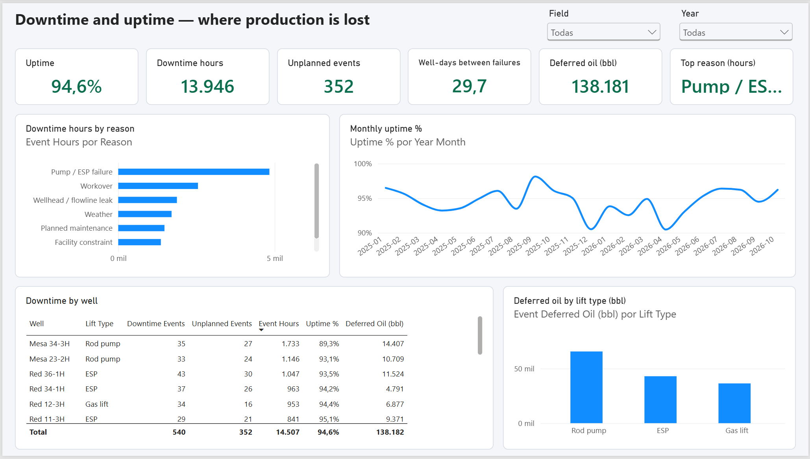
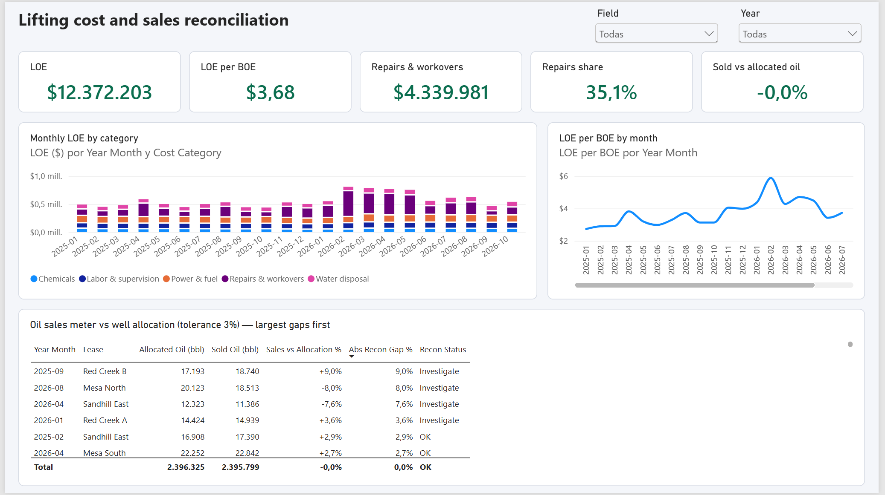
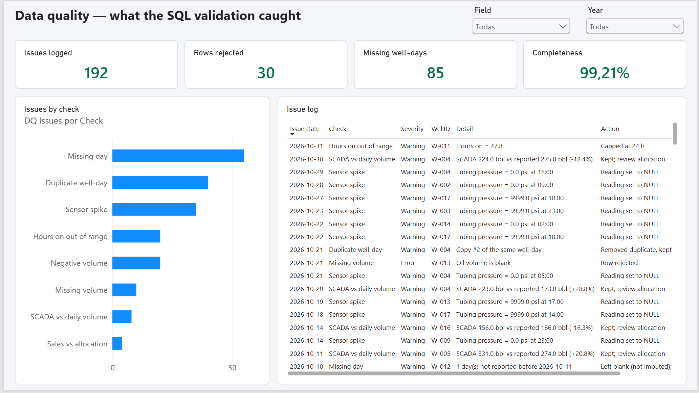
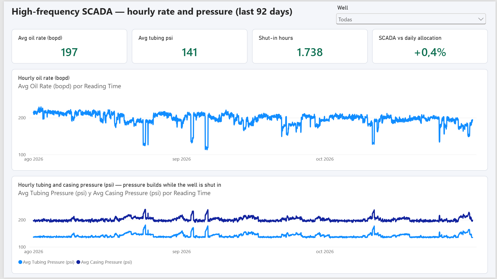

# Upstream Production Reporting — SQL ETL + Power BI


An end-to-end reporting project for an upstream oil & gas operation: raw field data goes through a **SQL ETL with validation and reconciliation**, and lands in a **Power BI model** that reports production, uptime, downtime, lifting cost and data quality, plus a **high-frequency (hourly SCADA)** view.

> All data is **synthetic** (generated with `scripts/generate_data.py`, fixed seed): a fictional asset with 18 wells in 3 fields, Jan 2025 – Oct 2026. Production follows Arps decline curves, and the raw files include deliberate errors so the validation layer has real work to do.



## What it covers

| Need | How it is done here |
|---|---|
| Production volumes, BOE, well performance | Daily allocated oil / gas / water per well, BOE (6 mcf = 1 BOE), GOR, water cut, rank by well |
| Actual vs plan | Type-curve forecast per well (Arps hyperbolic decline) built in SQL; variance in BOE and % |
| Downtime and uptime | 540 downtime events by reason and category, uptime %, deferred production, well-days between failures |
| Operational cost | Lease operating expenses (LOE) by category, **LOE per BOE**, repairs share |
| SQL and ETL | Staging → validation → marts in plain SQL (window functions, recursive CTE, reconciliation joins) |
| Data validation and reconciliation | 8 checks log every issue with the action taken; row counts reconcile end to end; sales meter vs allocation |
| Large / high-frequency time series | ~40,000 hourly SCADA readings (pressure and rate), spike removal, hourly vs daily check |
| Dashboard performance | Heavy work pushed to SQL, star schema, import of pre-aggregated marts, keys and helper columns hidden |

## Pipeline



`python scripts/run_etl.py` loads the raw CSVs into SQLite, runs the three SQL files in order, exports the marts and writes [`docs/data_quality_report.md`](docs/data_quality_report.md).

### SQL highlights

Missing days found with a window function (gaps between consecutive reports of the same well):

```sql
SELECT well_id, prod_date,
       JULIANDAY(prod_date)
         - JULIANDAY(LAG(prod_date) OVER (PARTITION BY well_id ORDER BY prod_date)) AS gap_days
FROM stg_daily_production
WHERE dup_rank = 1          -- dup_rank = ROW_NUMBER() OVER (PARTITION BY well, day)
```

Type-curve forecast on a full calendar spine (recursive CTE), so missing or rejected days still count against the plan:

```sql
WITH RECURSIVE calendar(d) AS (
    SELECT DATE('2025-01-01')
    UNION ALL SELECT DATE(d, '+1 day') FROM calendar WHERE d < (SELECT MAX(prod_date) FROM stg_daily_production)
)
-- q(t) = qi / (1 + b * Di * t)^(1/b)
SELECT ..., s.qi_bopd / POW(1 + s.b_factor * s.di_annual * t_years, 1.0 / s.b_factor) AS forecast_oil_bbl
```

Full SQL: [`sql/01_staging.sql`](sql/01_staging.sql) · [`sql/02_validation.sql`](sql/02_validation.sql) · [`sql/03_marts.sql`](sql/03_marts.sql)

## Data quality and reconciliation

| Check | Issues | Action |
|---|---:|---|
| Missing day (gap in reports) | 55 | Left blank, not imputed; forecast still counts |
| Duplicate well-day | 40 | Duplicate removed |
| Sensor spike (0 or 9,999 psi) | 35 | Reading set to NULL |
| Negative volume | 20 | Row rejected |
| Hours on outside 0–24 | 20 | Capped at 24 h |
| Missing volume | 10 | Row rejected |
| SCADA vs daily volume (> 10%) | 8 | Kept, flagged for allocation review |
| Sales meter vs allocation (> 3%) | 4 | Flagged for investigation |

Row reconciliation for daily production: **10,789 raw rows − 40 duplicates − 30 rejected = 10,719 clean well-days** ✅. Against the 10,804 expected well-days that gives **99.21% completeness**, the same figure the report shows.

## Power BI model

Star schema: `Production`, `Downtime`, `SCADA Hourly`, `LOE`, `Sales Recon` and `DQ Issues` facts around `Wells`, `Leases` and a DAX `Date` table. LOE and sales are booked per **lease**, so they connect through the `Leases` dimension, and `LOE per BOE` returns blank at well level instead of a wrong number.

### DAX measures (51)

| Folder | Examples | Patterns |
|---|---|---|
| 1. Volumes | BOE, Avg Daily BOE, Current Rate (7d), Water Cut %, GOR, BOE MoM %, 30-day rolling | `DIVIDE`, `DATESINPERIOD`, `DATEADD`, daily-rate normalisation |
| 2. Forecast | Forecast BOE, Variance vs Forecast %, Deferred Oil, Well Rank | `RANKX` over `ALLSELECTED` |
| 3. Uptime & downtime | Uptime %, Unplanned Events, Days Between Unplanned Events, Top Downtime Reason | `CALCULATE` filters, `TOPN` + `MAXX` |
| 4. Cost | LOE, LOE per BOE, Repairs % of LOE | `ISFILTERED` guard for grain mismatch |
| 5. Reconciliation & DQ | Sales vs Allocation %, Recon Status, Data Completeness % | tolerance rules |
| 6. SCADA (hourly) | Avg Tubing Pressure, Shut-in Hours, SCADA vs Reported % | **virtual relationship with `TREATAS`** |
| 7. HTML | KPI strip, field cards, well alerts, downtime Pareto | DAX that returns HTML for the *HTML Content* visual, `CONCATENATEX`, `ADDCOLUMNS` + `FILTER` |

Full code: [`MEASURES.md`](MEASURES.md).

### Validation

Report totals were cross-checked against direct SQL queries on the marts:

| Metric | Power BI | SQL |
|---|---:|---:|
| Total BOE | 3,360,600 | 3,360,600 ✅ |
| Variance vs type curve | −6.9% | −6.9% ✅ |
| Average daily BOE | 5,023 | 5,023 ✅ |
| Uptime | 94.6% | 94.6% ✅ |
| Water cut | 50.7% | 50.7% ✅ |
| LOE / LOE per BOE | $12,372,203 / $3.68 | $12,372,203 / $3.68 ✅ |
| Downtime events / unplanned / hours | 540 / 352 / 14,507 | 540 / 352 / 14,507 ✅ |
| Oil allocated vs sold | 2,396,325 vs 2,395,799 | same ✅ |

`Downtime Hours` (13,946, from reported hours on) is lower than `Event Hours` (14,507, from the event log) on purpose: overlapping events on the same well-day are capped at 24 h, and days with no valid report have no hours on.

## Report pages

1. **Ops Brief (HTML)**: KPI tiles with status colours, one card per field, an exception list of wells to review and a downtime Pareto, all rendered from DAX-generated HTML.
2. **Production**: daily rate vs type curve, actual vs forecast by field, well scorecard.
3. **Downtime**: hours by reason, monthly uptime, downtime by well, deferred oil by lift type.
4. **Cost & Reconciliation**: monthly LOE by category, LOE per BOE, sales meter vs allocation with largest gaps first.
5. **Data Quality**: issues by check and the full issue log.
6. **SCADA Hourly**: hourly oil rate and tubing / casing pressure for a selected well.

| | |
|---|---|
|  |  |
|  |  |



## How to run

1. `python scripts/generate_data.py` (optional: the raw files are already in `data/raw/`)
2. `python scripts/run_etl.py` (optional: the marts are already in `data/mart/`)
3. Open `Production Reporting.pbip` in Power BI Desktop → *Transform data → Edit parameters* → set **DataFolder** to the `data\mart\` folder of your clone (with the trailing backslash) → Refresh.
   The first page uses the free **HTML Content** visual from AppSource.

Only the Python standard library is needed (`csv`, `sqlite3`).

## Project structure

```
data/raw/                               raw extracts with deliberate errors
data/mart/                              clean tables loaded by Power BI
sql/                                    staging, validation and mart SQL
scripts/generate_data.py                synthetic data generator (fixed seed)
scripts/run_etl.py                      runs the SQL ETL and the data-quality report
docs/data_quality_report.md             output of the last ETL run
Production Reporting.SemanticModel/     model in TMDL
Production Reporting.Report/            report definition (pages and visuals)
MEASURES.md                             all DAX measures
screenshots/                            report pages
```

---
Ramiro Di Bernardo · [LinkedIn](https://www.linkedin.com/in/ramiro-di-bernardo) · [GitHub](https://github.com/Ramiro-DiBernardo)
